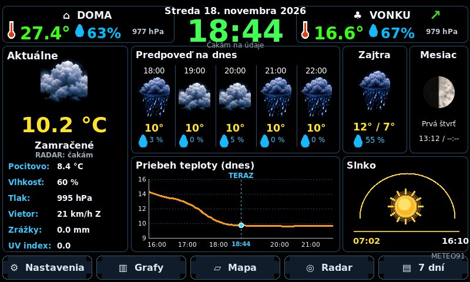
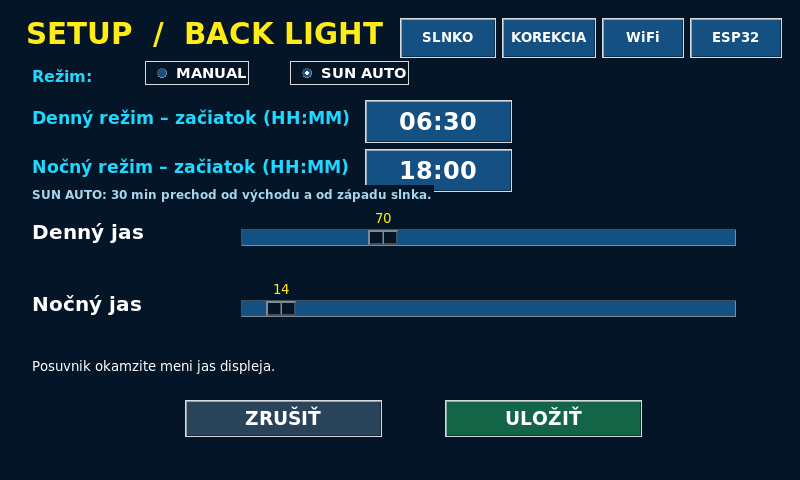

METEO – WiFi meteostanica

Vlastný projekt meteostanice postavenej na Raspberry Pi so 7" dotykovým displejom a externým senzorovým modulom ESP32-C6.

Funkcie

Zobrazovanie meteorologických údajov na dotykovom displeji

Bezdrôtový prenos údajov cez WiFi

Grafické používateľské rozhranie

Vzdialené zobrazenie a ovládanie cez mobilný telefón

Nastavenie meteostanice priamo na displeji

<!-- METEO PUBLIC FOTO START -->

### Hlavna obrazovka

### Hodiny

### SETUP

<!-- METEO PUBLIC FOTO END -->

Zdrojový kód projektu nie je verejne dostupný. 

V prípade záujmu o zdrojový kód alebo technické informácie ma môžete kontaktovať e-mailom.

Kontakt: eligo2233@gmail.com

Projekt je určený na prezentáciu vlastnej konštrukcie meteostanice.
