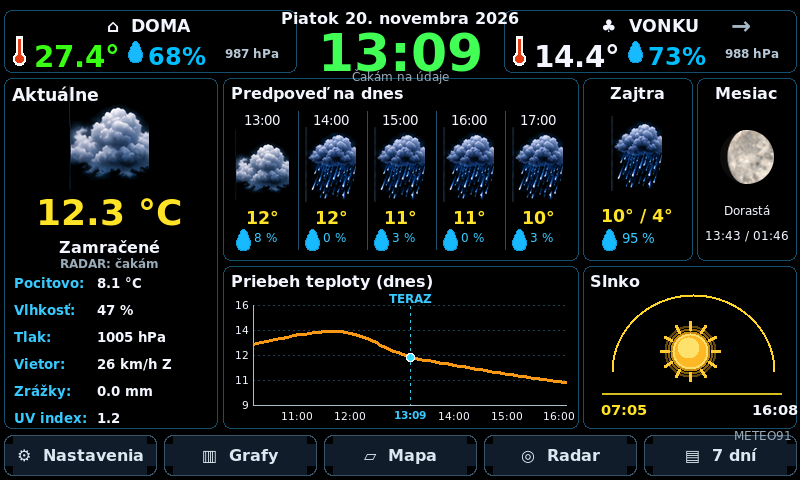
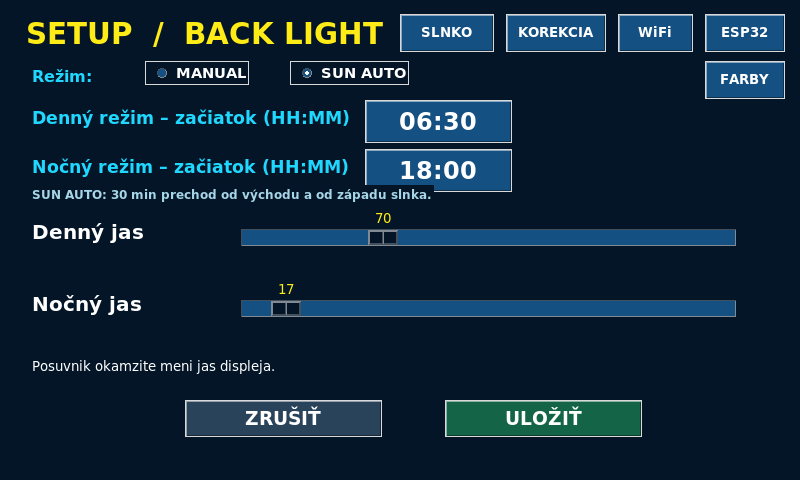
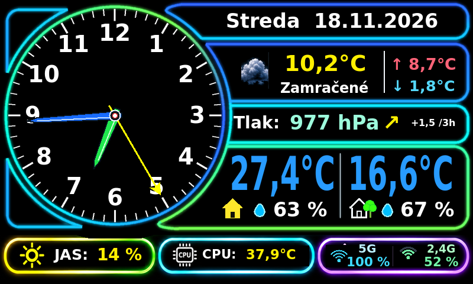

# METEO – Wi-Fi meteostanica

**🇸🇰 Slovensky (SK)** | [🇬🇧 English (EN)](README_EN.md)

Vlastný projekt meteostanice postavenej na **Raspberry Pi**, so 7-palcovým dotykovým displejom a samostatným vonkajším meracím modulom. Grafické používateľské rozhranie s rozlíšením **800 × 480 px** vychádza z aktuálnej verzie **METEO234**.

## Hardvér

- **Raspberry Pi** – hlavná jednotka, spracovanie nameraných údajov, predpovede počasia a ovládanie dotykového rozhrania.
- **Oficiálny 7" dotykový displej pre Raspberry Pi** – zobrazenie hodín, meteorologických údajov a nastavení.
- **Vnútorný senzor BME280** – teplota, relatívna vlhkosť a atmosférický tlak; pripojenie cez **I²C** (adresa `0x77`), s pravidelným meraním.
- **Vonkajší modul ESP32-C6 + BME280** – samostatné meranie teploty, vlhkosti a tlaku. Údaje odosiela cez **2,4 GHz Wi-Fi**.
- **Wi-Fi adaptér TP-Link pre 5 GHz** – pripojenie hlavnej jednotky k domácej sieti, s indikáciou sily signálu.

## Funkcie a ovládanie obrazoviek

### 1. Hlavná meteorologická obrazovka

- Aktuálna vnútorná a vonkajšia **teplota, vlhkosť a tlak**.
- Dátum, čas a aktuálny stav počasia s **animovanými ikonami**.
- Predpoveď na najbližších **5 hodín**, predpoveď na zajtra a samostatná **7-dňová predpoveď**.
- Graf vývoja teploty v priebehu dňa a samostatná obrazovka grafu s časovou osou.
- Pocitová teplota, vietor, zrážky a UV index podľa dostupných meteorologických údajov.
- Fáza Mesiaca, údaje o Slnku a časy východu a západu.
- Prístup k obrazovkám **Nastavenia, Grafy, Mapa, Radar a 7 dní**.
- Predpoveď využíva údaje **SHMÚ ALADIN** s náhradným zdrojom **Open-Meteo**, ak nie sú údaje SHMÚ dostupné.
- **Foreca** poskytuje ikony aktuálneho počasia, nasledujúcich 5 hodín a 7-dňovej predpovede; pri nedostupnosti služby zostávajú pôvodné zdroje počasia.
- Stavový riadok uvádza aktuálnosť meteorologických údajov a použitie ikon Foreca.

### 2. Obrazovka s analógovými hodinami

- Veľký analógový ciferník s aktualizáciou ručičiek.
- Aktuálny dátum, vnútorná a vonkajšia teplota a vlhkosť, atmosférický tlak a jeho 3-hodinový trend podľa dostupnej predpovede.
- Aktuálne počasie s animovanou ikonou a dennými minimami a maximami teploty; bez zobrazenia viacdňovej predpovede alebo radarovej mapy na ciferníku.
- Indikácia sily domácej **5 GHz Wi-Fi** a spojenia s vonkajším modulom.
- Ukazovatele **jasu displeja** a **teploty procesora Raspberry Pi**.
- Dotykom na obrazovku hodín sa zobrazí hlavná meteorologická obrazovka; dotykom na voľnú plochu hlavnej obrazovky sa obnovia hodiny.

### 3. SETUP – nastavenia meteostanice

- **BACK LIGHT:** ručné nastavenie denného a nočného jasu, časov režimov a okamžitý náhľad zmeny jasu.
- **SUN AUTO:** automatické riadenie jasu podľa východu a západu slnka s plynulým **30-minútovým prechodom**.
- **SLNKO:** samostatná korekcia časov automatického prepínania podľa východu a západu slnka, v rozsahu ±120 minút a krokom 10 minút; bez zmeny údajov predpovede.
- **KOREKCIA:** kalibrácia zobrazovanej teploty a vlhkosti vnútorného BME280.
- **WiFi:** výber a konfigurácia domácej bezdrôtovej siete prostredníctvom dotykovej klávesnice.
- **ESP32:** nastavenie pripojenia vonkajšieho modulu k 2,4 GHz sieti.
- **FARBY:** samostatné nastavenie farieb zobrazenia vnútornej a vonkajšej teploty s trvalým uložením.
- Možnosť nastavenia uložiť alebo zrušiť.

## Radar a ďalšie funkcie

- **SHMÚ radar ZMAX:** celoobrazovkový radar so skutočnými **5-minútovými radarovými meraniami**, animáciou, časovým posuvom a históriou približne **50 minút**.
- **METEO234:** mimo radarovej obrazovky sa pre zistenie zrážok v okolí stanice spracúva iba najnovšie meranie SHMÚ a malá oblasť okolo stanice. Celá radarová história a mapové vrstvy sa načítajú až po otvorení radaru.
- Stav **„ZRÁŽKY V OKOLÍ“** vychádza zo skutočného radarového merania; pri nedostupných alebo starých dátach sa zobrazí upozornenie.
- **Mapa:** mapové podklady **OpenStreetMap**.
- Bezdrôtový zber údajov z vonkajšieho modulu s kontrolou aktuálnosti meraní.
- Možnosť vzdialeného zobrazenia a ovládania cez mobilný telefón.
- **Úspornejšia prevádzka METEO234:** pri prekrytí hlavnej obrazovky oknom SETUP sa obmedzuje zbytočné prekresľovanie; po zatvorení sa zobrazenie aktualizuje. Kontrola internetového pripojenia uprednostňuje skutočne prijaté meteorologické údaje pred pomocnými testmi.

## Fotografie skutočných obrazoviek

Snímky pochádzajú priamo z bežiacej meteostanice. Makro **PUBLIC FOTO** ich môže aktualizovať pod rovnakými názvami bez zmeny tejto dokumentácie.

<!-- METEO PUBLIC FOTO START -->

### Hlavná obrazovka

### Nastavenia

### Hodiny

<!-- METEO PUBLIC FOTO END -->

## Zdrojový kód a kontakt

Zdrojový kód projektu nie je verejne dostupný.

V prípade záujmu o zdrojový kód alebo technické informácie ma môžete kontaktovať e-mailom: **eligo2233@gmail.com**.

Projekt je určený na prezentáciu vlastnej konštrukcie meteostanice.
