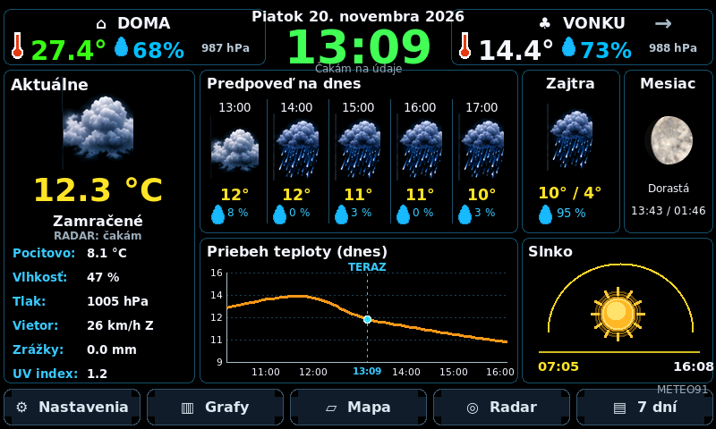
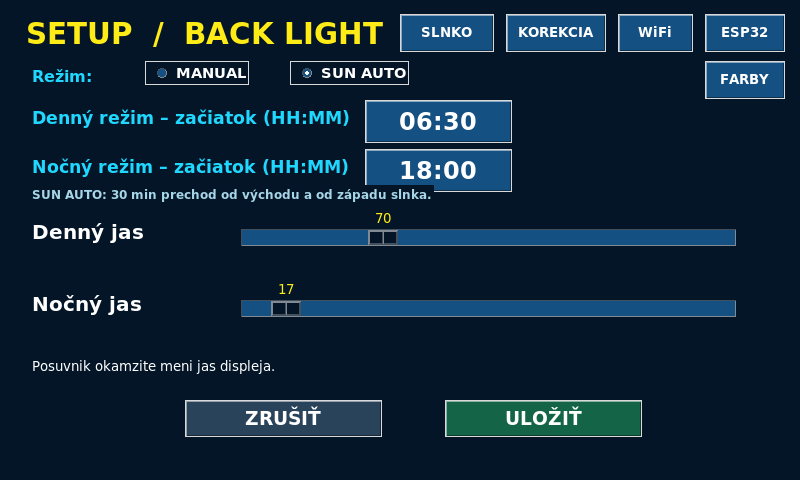
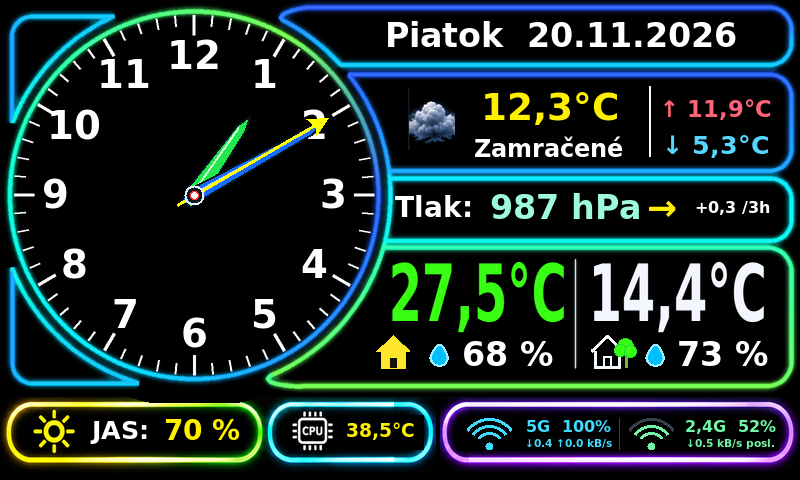

# METEO – Wi-Fi Weather Station

[🇸🇰 Slovensky (SK)](README.md) | **🇬🇧 English (EN)**

A custom weather station built on a **Raspberry Pi**, featuring a 7-inch touchscreen and a separate outdoor sensor module. Its **800 × 480 px** graphical user interface shows the METEO project.

## Hardware

- **Raspberry Pi** – main unit for processing sensor readings, weather forecasts and touchscreen interaction.
- **Official 7" Raspberry Pi touchscreen** – displays clocks, weather measurements and settings.
- **Indoor BME280 sensor** – measures temperature, relative humidity and atmospheric pressure; connected over **I²C** (address `0x77`) with regular sampling.
- **Outdoor ESP32-C6 + BME280 module** – independently measures temperature, humidity and pressure and sends the readings over **2.4 GHz Wi-Fi**.
- **TP-Link 5 GHz Wi-Fi adapter** – connects the main unit to the home network and provides signal-strength indication.

## Features and Screen Navigation

### 1. Main Weather Screen

- Current indoor and outdoor **temperature, humidity and atmospheric pressure**.
- Date, time and current weather conditions with **animated icons**.
- A forecast for the next **5 hours**, tomorrow's forecast and a separate **7-day forecast**.
- A daily temperature trend chart and a dedicated graph screen with a time axis.
- Feels-like temperature, wind, precipitation and UV index when available from the weather data source.
- Moon phase, solar information, sunrise and sunset times.
- Access to the **Settings, Charts, Map, Radar and 7 Days** screens.
- Forecast data from **SHMÚ ALADIN**, with **Open-Meteo** as a fallback when SHMÚ data is unavailable.

### 2. Analog Clock Screen

- Large analog clock face with updating hands.
- Current date, indoor and outdoor temperature and humidity, atmospheric pressure and its 3-hour trend according to the available forecast.
- Current weather with an animated icon and daily minimum/maximum temperatures, without displaying the multi-day forecast or radar map on the clock face.
- Signal indicators for the home **5 GHz Wi-Fi** network and the outdoor sensor module.
- Indicators for **display brightness** and **Raspberry Pi CPU temperature**.
- Touching the clock screen opens the main weather screen; touching an unused area of the main screen returns to the clock.

### 3. SETUP – Weather Station Settings

- **BACK LIGHT:** manual configuration of daytime/nighttime brightness and schedule, with an immediate brightness preview.
- **SUN AUTO:** automatic brightness control based on sunrise and sunset with a smooth **30-minute transition**.
- **SLNKO (Sun):** separate adjustment of automatic switching times relative to sunrise and sunset, within ±120 minutes in 10-minute steps; without changing forecast data.
- **KOREKCIA (Correction):** calibration of the temperature and humidity values displayed from the indoor BME280 sensor.
- **WiFi:** selection and configuration of the home wireless network using an on-screen keyboard.
- **ESP32:** configuration of the outdoor module's connection to the 2.4 GHz network.
- Settings can be saved or canceled.

## Radar and Additional Features

- **SHMÚ ZMAX Radar:** full-screen radar with actual **5-minute radar observations**, animation, timeline and approximately **50 minutes of history**.
- Radar frames continue loading in the background while the analog clock screen is displayed, without requiring screen changes.
- **Map:** **OpenStreetMap** mapping data.
- Wireless reception of outdoor readings with checks for data freshness.
- Remote viewing and control from a mobile phone.

## Photos of the Actual Screens

These screenshots were captured directly from the running weather station. The **PUBLIC FOTO** macro can update them under the same filenames without changing this documentation.

<!-- METEO PUBLIC FOTO START -->

### Main screen

### Settings

### Clock

<!-- METEO PUBLIC FOTO END -->

## Source Code and Contact

The project's source code is not publicly available.

For source-code inquiries or technical information, contact me by email: **eligo2233@gmail.com**.

This project showcases a custom-built weather station.
